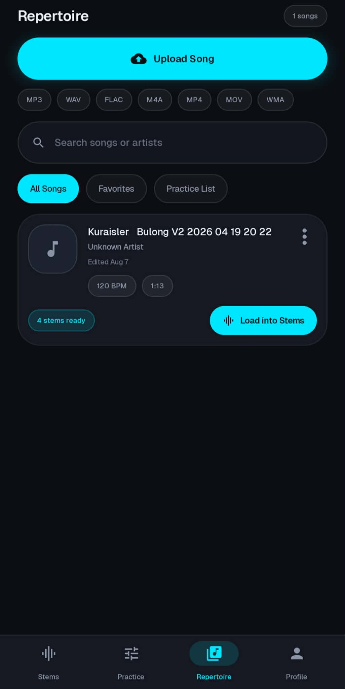
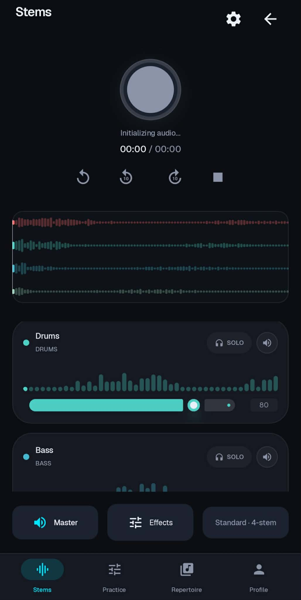
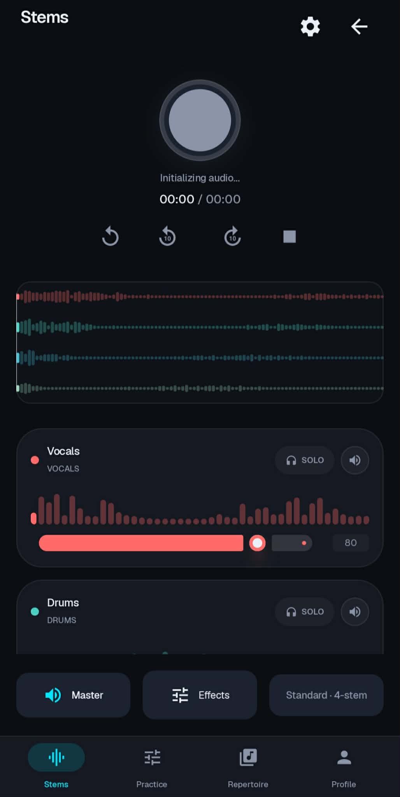
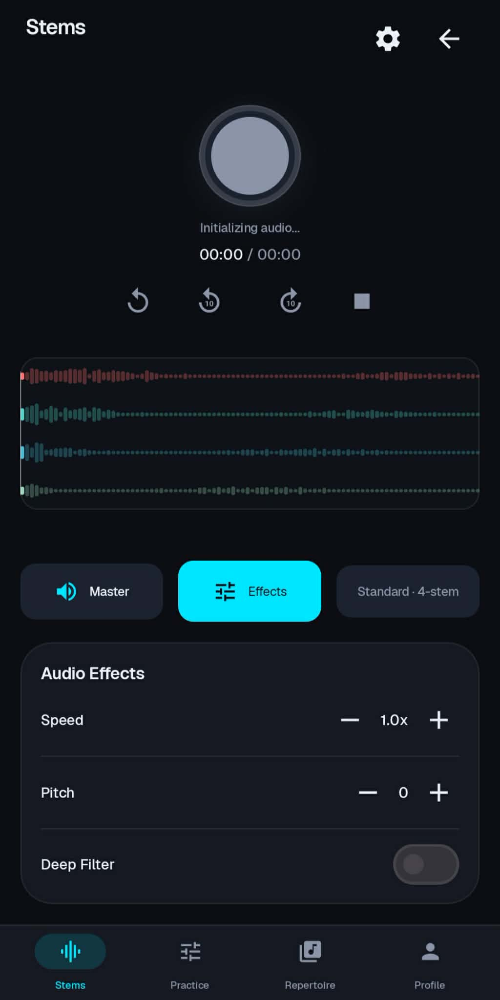
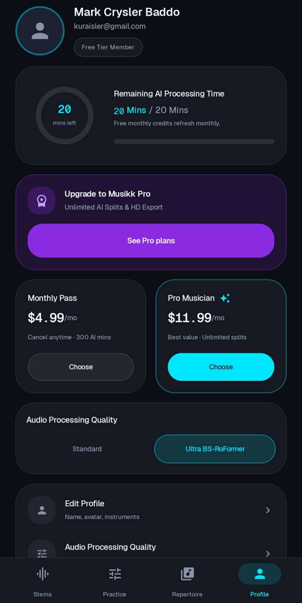
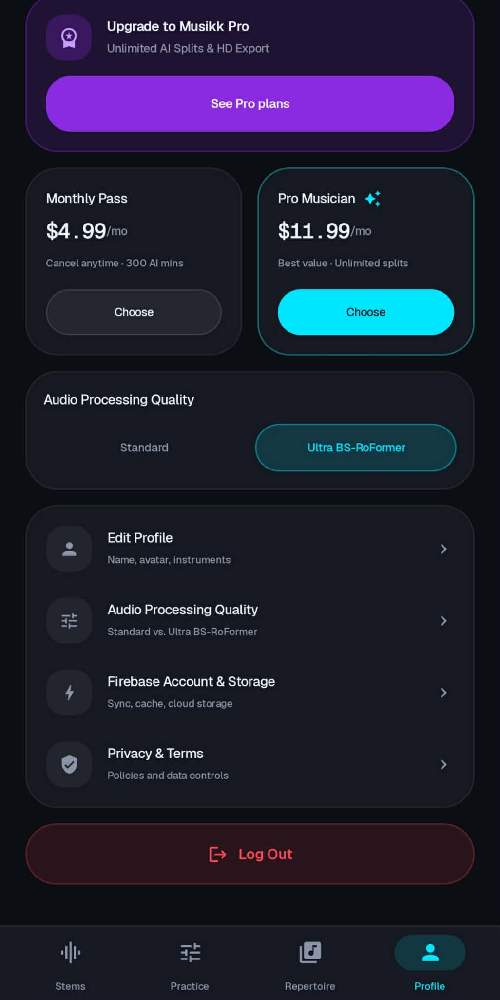

# Musikk

An Android music-practice app for separating audio, balancing stems, and rehearsing difficult passages.

**Android** · **In Development** · 2026

[Portfolio](https://kuraisler.xyz)

## Purpose

Musikk helps musicians practice with parts of a recording instead of only the full mix. It combines a song library, separation workflow, multi-track playback, and practice controls so users can isolate a part, reduce competing instruments, or repeat a passage.

## Intended users

Singers, instrumentalists, and hobby musicians practicing with recordings they are entitled to use.

## Main capabilities

- Upload songs and organize a repertoire with processing status.
- Request stem separation through a configured processing backend.
- Adjust stem volume, mute, and solo controls in a shared mixer.
- Use playback speed, pitch, and A/B loop controls for practice.

## How it was built

### Android application

Kotlin and Jetpack Compose provide the library, mixer, practice, and profile screens.

### Audio processing

A Python FastAPI backend runs Demucs separation jobs. Android services manage processing requests, while Media3 ExoPlayer supports synchronized stem playback.

### Cloud library

Firebase Authentication and Firestore manage accounts and song metadata. Cloudflare R2 holds source audio and generated files, accessed through the app storage service.

## Technology stack

| Responsibility | Technologies |
| --- | --- |
| Android interface | Kotlin, Jetpack Compose, Navigation Compose |
| Playback & networking | Media3 ExoPlayer, OkHttp, Retrofit |
| Separation backend | Python, FastAPI, Demucs |
| Accounts & storage | Firebase Auth, Cloud Firestore, Cloudflare R2 |

## Project scope and current state

A personal project in development. Separation requires a working backend; available independent stems depend on the model. Some extended preset labels map to existing outputs, demo fallback can reuse source audio, and subscription screens do not establish a completed payment integration.

## Source guide

- [`app/src/main/java/com/kurai/musikk/ui/`](app/src/main/java/com/kurai/musikk/ui/)
- [`app/src/main/java/com/kurai/musikk/data/`](app/src/main/java/com/kurai/musikk/data/)
- [`main.py`](main.py)

## Development setup

Open the Android project in Android Studio. Configure Firebase and the processing and storage endpoints expected by the app. main.py is the FastAPI backend entry point; local processing requires Python, an ASGI server, upload support, Demucs, FFmpeg, and compatible model/runtime dependencies. Validate the backend before testing separation. The repository does not provide a single verified command that provisions every service.

## Screenshot and module walkthrough

Expand a screen below to see the capture and an explanation of the module, its visible controls, and its role in the application.

<strong>01 · App launch identity</strong>

The splash screen presents the Musikk mark and AI Stem Studio label before the main interface loads. It establishes the application identity without yet showing a processing or playback result.

<strong>02 · Repertoire and song preparation</strong>

Upload, format filters, search, and collection tabs organize the song library. A saved track reports four stems ready and offers Load into Stems, linking processing status to the mixer.

<strong>03 · Instrument-channel mixer</strong>

The stem screen combines shared transport, a multichannel waveform, and individual instrument strips with volume and solo controls. Audio is still initializing in this capture, so it demonstrates mixer controls rather than confirmed playback.

<strong>04 · Vocal-channel controls</strong>

The vocals strip is visible above the drums strip, with a fader, numeric level, and solo/mute-style controls. Users can adjust a part independently when valid stem audio has been loaded.

<strong>05 · Playback effects panel</strong>

The Effects tab reveals speed, pitch, and deep-filter controls underneath the shared waveform. These settings support slowing a passage or transposing playback for practice; the captured transport remains in its initializing state.

<strong>06 · Profile and processing allowance</strong>

The profile shows account identity, remaining AI-processing minutes, upgrade cards, and processing-quality selection. It communicates usage and plan options; the visible prices do not establish a completed payment integration.

<strong>07 · Audio, storage, and account settings</strong>

Profile rows lead to identity editing, processing quality, Firebase/storage information, privacy, and logout. The screen groups technical preferences and account actions below the plan presentation.

<strong>08 · Account onboarding</strong>

A product introduction leads into Google sign-in or email/password account creation, with a marketing preference and terms links. This is the entry flow before building a repertoire and using the practice tools.

---

Project by [Mark Crysler Baddo](https://github.com/Kuraisura) · [Portfolio](https://kuraisler.xyz)
